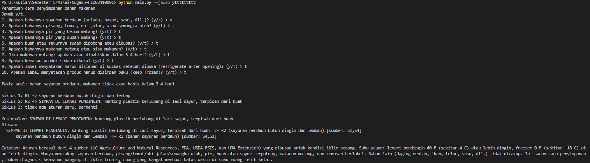
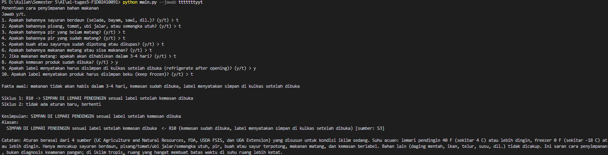

# Tugas 5 Kecerdasan Buatan: Sistem Pakar Penentuan Cara Penyimpanan Bahan Makanan

- **Nama:** Rival Hosam Wilmadani
- **NIM:** F1D02410091

## 1. Topik dan cara menjalankan

Topik: **menentukan cara penyimpanan bahan makanan** (suhu ruang, lemari pendingin, atau freezer) berdasarkan jenis bahan, kondisi bahan, dan label kemasan. Fokusnya cara penyimpanan, bukan diagnosis keamanan pangan.
Program membaca file aturan `kb_penyimpanan.json`, menanyakan fakta ke pengguna, lalu menyimpulkan dengan *forward chaining* yang mesinnya ditulis sendiri (`main.py`).

- Bahasa: Python 3.8 ke atas, tanpa library tambahan (hanya `json` dan `argparse`).
- Menjalankan (interaktif, di terminal): `python main.py`
- Menjalankan dengan jawaban otomatis: `python main.py --jawab ytttttttt` (satu huruf y/t per pertanyaan yang ditanyakan)
- Menjalankan kasus uji otomatis: `python uji.py`

Pertanyaan "habis dalam 3-4 hari?" hanya ditanyakan bila bahannya makanan matang, sehingga jumlah huruf pada `--jawab` bisa 9 atau 10.

Struktur repository: `kb_penyimpanan.json` (aturan + sumber + pertanyaan), `main.py` (mesin FC), `uji.py` (kasus uji), `screenshot/`, `README.md`.

## 2. Sumber

| Kode | Judul | Penerbit | URL | Diakses |
|---|---|---|---|---|
| S1 | Storing Fresh Fruits and Vegetables for Better Taste (Kader, Thompson, Sylva, Harris) | UC Agriculture and Natural Resources, Publication #21590 | https://ucanr.edu/sites/default/files/2011-07/115275.pdf | 13 Nov 2026 |
| S2 | Refrigerator Thermometers: Cold Facts about Food Safety (FDA Facts, Januari 2017) | U.S. Food and Drug Administration | https://www.fda.gov/media/80676/download | 13 Nov 2026 |
| S3 | Keep Food Safe! Food Safety Basics (lembar fakta; salinan arsip) | USDA Food Safety and Inspection Service, via UNT Web Archive | https://webarchive.library.unt.edu/web/20121014010316/http:/www.fsis.usda.gov/Fact_Sheets/Keep_Food_Safe_Food_Safety_Basics/index.asp | 13 Nov 2026 |
| S4 | Quick Storage Guide for Vegetable Crops (Deltsidis), Circular 1205 | University of Georgia Cooperative Extension | https://fieldreport.caes.uga.edu/publications/C1205/quick-storage-guide-for-vegetable-crops/ | 13 Nov 2026 |

## 3. Tabel aturan

`dan` = semua syarat harus ada, `atau` = salah satu cukup. Fakta yang tidak pernah menjadi hasil aturan ditanyakan ke pengguna (jawaban "y" atau "t" menghasilkan fakta yang ditulis pada bagian `pertanyaan` di file aturan).

| Aturan | IF | THEN | Sumber | Dasar di sumber |
|---|---|---|---|---|
| R1 | bahan sayuran berdaun | sayuran berdaun butuh dingin dan lembap | S4, S1 | sayuran berdaun disimpan pada 32-41 F dengan kelembapan relatif di atas 95% (S4) |
| R2 | sayuran berdaun butuh dingin dan lembap | SIMPAN DI LEMARI PENDINGIN: kantong plastik berlubang di laci sayur, terpisah dari buah | S1, S4 | produk dingin disimpan dalam kantong plastik berlubang di laci; pisahkan buah dari sayur karena etilen (S1, S4) |
| R3 | bahan pisang, tomat, ubi jalar, atau semangka utuh | SIMPAN DI SUHU RUANG: jauhkan dari sinar matahari langsung, jangan di kulkas | S1 | pisang menghitam dan tidak manis, tomat kehilangan rasa, semangka kehilangan rasa dan warna di kulkas |
| R4 | bahan pir belum matang | SIMPAN DI SUHU RUANG sampai matang, jauhkan dari sinar matahari langsung | S1 | pir menguning, lembut, dan manis di meja |
| R5 | bahan pir sudah matang | SIMPAN DI LEMARI PENDINGIN dan pakai dalam 1-3 hari | S1 | setelah matang, pir dapat disimpan 1-3 hari di kulkas |
| R6 | buah atau sayur sudah dipotong atau dikupas | SIMPAN DI LEMARI PENDINGIN segera setelah dipotong atau dikupas | S1 | produk potong siap saji disimpan di kulkas |
| R7 | bahan makanan matang atau sisa makanan | makanan matang harus didinginkan dalam 2 jam (1 jam jika di atas 32 C) | S2, S3 | sisa makanan masuk kulkas atau freezer dalam 2 jam, 1 jam bila di atas 90 F (32 C) |
| R8 | makanan matang harus didinginkan dalam 2 jam **AND** makanan akan habis dalam 3-4 hari | SIMPAN DI LEMARI PENDINGIN: wadah tertutup dangkal, habiskan dalam 3-4 hari | S2, S3 | wadah tertutup, bagi dalam wadah kecil; sisa makanan matang dipakai dalam 3-4 hari |
| R9 | makanan matang harus didinginkan dalam 2 jam **AND** makanan tidak akan habis dalam 3-4 hari | SIMPAN DI FREEZER: wadah tertutup dangkal, bagi dalam porsi kecil | S2, S3 | freezer 0 F atau lebih dingin; makanan beku tetap aman, hanya kualitas yang bisa menurun |
| R10 | kemasan sudah dibuka **AND** label menyatakan simpan di kulkas setelah dibuka | SIMPAN DI LEMARI PENDINGIN sesuai label setelah kemasan dibuka | S3 | contoh: mayones komersial berlabel "refrigerate after opening" |
| R11 | label menyatakan simpan beku | SIMPAN DI FREEZER sesuai label (simpan beku) | S3 | contoh: makanan beku siap saji berlabel "keep frozen" |

Ada 11 aturan dengan 9 kesimpulan akhir: suhu ruang (R3, R4), lemari pendingin (R2, R5, R6, R8, R10), freezer (R9, R11). Rantai aturan: R1 ke R2, R7 ke R8, dan R7 ke R9.

## 4. Metode: Forward Chaining

Dipilih karena pengguna mengetahui keadaan bahannya (jenis, kondisi, label) dan ingin tahu cara menyimpannya, sehingga alur dari fakta menuju kesimpulan paling natural.

```
memori <- fakta dari jawaban pengguna
ULANGI:
    cocok <- aturan yang syaratnya terpenuhi DAN hasilnya belum ada di memori
    JIKA cocok kosong: BERHENTI
    r <- cocok[0]
    tambahkan r.maka ke memori
    catat r sebagai asal r.maka (beserta syarat yang ada saat itu)
```

Kesimpulan akhir adalah fakta hasil aturan yang tidak dipakai sebagai syarat aturan lain yang dijalankan. Alasan ditampilkan dengan menelusuri `asal` dari kesimpulan akhir ke belakang. Pertanyaan "habis dalam 3-4 hari?" menghasilkan fakta berbeda untuk jawaban "y" dan "t" supaya R8 dan R9 tidak bertabrakan.

## 5. Kasus uji dan screenshot

| # | Jawaban | Kesimpulan |
|---|---|---|
| 1 | sayuran berdaun | SIMPAN DI LEMARI PENDINGIN: kantong plastik berlubang di laci sayur, terpisah dari buah |
| 2 | semua "t" | tidak ada (kasus negatif) |
| 3 | makanan matang, tidak habis dalam 3-4 hari | SIMPAN DI FREEZER: wadah tertutup dangkal, bagi dalam porsi kecil |

Perintah: `python main.py --jawab ytttttttt`, `python main.py --jawab ttttttttt`, dan `python main.py --jawab tttttytttt`.

Kasus 1: Sayur berdaun (R1, R2)

Kasus 2: Makanan matang yang tidak akan habis dalam 3-4 hari (R7, R9)

Kasus 3: Pisang utuh (R3)

Kasus 4: Kemasan dibuka dan label meminta penyimpanan di kulkas (R10)


`python uji.py` menjalankan 12 kasus (semua aturan, kasus dua kesimpulan sekaligus, dan dua kasus tanpa kesimpulan), semuanya lulus.

## 6. Batas keberlakuan

Pengetahuan dalam sistem ini berasal dari empat sumber: panduan penyimpanan buah dan sayur dari University of California (UC ANR) dan University of Georgia Extension, serta panduan penyimpanan makanan dari FDA dan USDA FSIS. Sumber-sumber ini disusun untuk kondisi iklim sedang, dengan acuan lemari pendingin 40 F (sekitar 4 C) atau lebih dingin dan freezer 0 F (sekitar -18 C) atau lebih dingin; di iklim tropis suhu ruang lebih hangat sehingga batas waktu di luar kulkas perlu lebih ketat. Sistem hanya mencakup sayuran berdaun, pisang/tomat/ubi jalar/semangka utuh, pir, buah atau sayur terpotong, makanan matang, dan kemasan berlabel; daging mentah, ikan, telur, susu, dan bahan lain tidak dicakup. Hasilnya adalah saran cara penyimpanan, bukan diagnosis keamanan pangan dan bukan keputusan akhir; periksa label produk dan panduan resmi setempat.

## 7. Penggunaan alat bantu AI

Saya menggunakan AI untuk membantu mencari dan membaca sumber, menyusun aturan, dan menulis kode serta README.