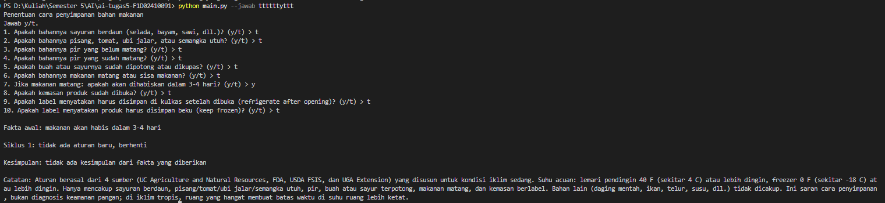
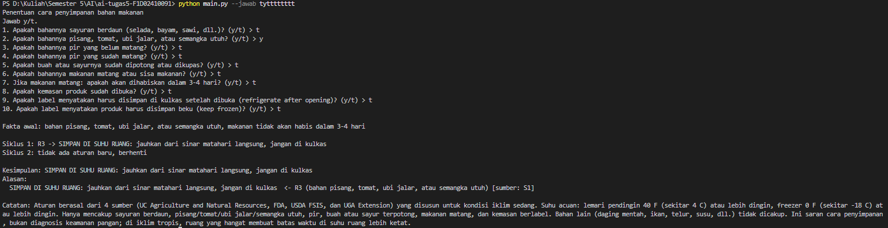

# Tugas 5 Kecerdasan Buatan: Sistem Pakar Kualitas Air Kolam Lele

- **Nama:** Rival Hosam Wilmadani
- **NIM:** F1D02410091

## 1. Topik dan cara menjalankan

Topik: **diagnosis masalah kualitas air kolam lele** (oksigen terlarut, amonia, nitrit, hidrogen sulfida, pH, suhu).
Program membaca file aturan `kb_lele.json`, menanyakan fakta ke pengguna, lalu menyimpulkan dengan *forward chaining* yang mesinnya ditulis sendiri (`main.py`).

- Bahasa: Python 3.8 ke atas, tanpa library tambahan (hanya `json` dan `argparse`).
- Menjalankan (interaktif): `python main.py`
- Menjalankan dengan jawaban otomatis (9 huruf y/t, urut sesuai pertanyaan): `python main.py --jawab ytttyyttt`
- Menjalankan kasus uji otomatis: `python uji.py`

Struktur repository:

```
kb_lele.json   file aturan + sumber
main.py        mesin forward chaining + antarmuka
uji.py         kasus uji otomatis
screenshot/    bukti tangkapan layar
README.md
```

## 2. Sumber

| Kode | Judul | Penerbit | URL | Diakses |
|---|---|---|---|---|
| S1 | Kualitas air kolam budidaya dan kolam terpal untuk pertumbuhan ikan Lele Sangkuriang pada kelompok pembudidaya ikan Lele di Kabupaten PALI Sumatera Selatan (Patriono, Amalia, Sitia, 2021) | Sriwijaya Bioscientia 2(3):83-88, Jurusan Biologi, Universitas Sriwijaya | https://doi.org/10.24233/sribios.2.3.2021.378 | 8 Nov 2026 |
| S2 | Efektivitas Bakteri Fotosintetik Rhobac dalam Meningkatkan Kualitas Air pada Budidaya Ikan Lele di Kolam Terpal (Haryasakti, Rudyanto, Kaharuddin, Wahyudi, 2025) | Jurnal Pertanian Terpadu 13(1):43-52, Sekolah Tinggi Pertanian Kutai Timur | https://ojs.stiperkutim.ac.id/index.php/jpt/article/download/610/296 | 8 Nov 2026 |

## 3. Tabel aturan

`dan` = semua syarat harus ada, `atau` = salah satu cukup. Fakta yang tidak pernah menjadi hasil aturan ditanyakan ke pengguna.

| Aturan | IF | THEN | Sumber | Dasar di sumber |
|---|---|---|---|---|
| R1 | DO di bawah 3 mg/L | hipoksia (oksigen kritis) | S1, S2 | DO di bawah 3 mg/L menyebabkan hipoksia (S2) dan menghambat pertumbuhan, stres, sampai kematian (S1) |
| R2 | amonia di atas 0,02 mg/L | amonia berbahaya | S2 | batas aman amoniak di kolam terpal umumnya kurang dari 0,02 mg/L |
| R3 | amonia berbahaya **AND** sisa pakan menumpuk | amonia berasal dari sisa pakan dan limbah ikan | S2 | amoniak muncul dari penguraian sisa pakan dan limbah metabolik ikan |
| R4 | nitrit di atas 0,1 mg/L | nitrit berbahaya | S2 | kadar nitrit aman kurang dari 0,1 mg/L |
| R5 | hipoksia (oksigen kritis) **AND** bau telur busuk dari dasar kolam | dugaan hidrogen sulfida (H2S) di dasar kolam | S2 | H2S berbau telur busuk dan terbentuk pada kondisi rendah oksigen/anaerob |
| R6 | pH di bawah 6,5 **OR** pH di atas 8,5 | pH di luar batas ideal | S1, S2 | pH ideal 6,5-8,5 (S2); S1 mencatat pertumbuhan optimal pada pH 6,5-9,0 |
| R7 | suhu di luar 25-30 C | suhu di luar batas ideal | S1, S2 | kisaran suhu 25-30 C (S2); S1 memuat kisaran sejenis (misalnya 26-31 C) |
| R8 | hipoksia (oksigen kritis) **AND** amonia berbahaya | kondisi kritis, ikan berisiko stres dan mati | S1, S2 | masing-masing hipoksia dan amonia tinggi menyebabkan stres dan kematian; aturan ini menggabungkan keduanya |
| R9 | dugaan hidrogen sulfida (H2S) di dasar kolam **AND** aerasi kurang | perlu aerasi dan sirkulasi untuk menekan H2S | S2 | H2S tinggi dapat diatasi dengan aerasi dan sirkulasi |

Ada 9 aturan dan 7 kesimpulan akhir. Rantai: R1 menghasilkan "hipoksia" yang dipakai R5 dan R8; R5 menghasilkan "dugaan H2S" yang dipakai R9; R2 menghasilkan "amonia berbahaya" yang dipakai R3 dan R8.

## 4. Metode: Forward Chaining

Dipilih karena pengguna sudah punya data pengukuran (DO, pH, suhu, dst.) dan ingin tahu kesimpulannya, sehingga alur dari fakta menuju kesimpulan paling natural.

```
memori <- fakta yang dijawab "y"
ULANGI:
    cocok <- aturan yang syaratnya terpenuhi DAN hasilnya belum ada di memori
    JIKA cocok kosong: BERHENTI
    r <- cocok[0]
    tambahkan r.maka ke memori
    catat r sebagai asal r.maka (beserta syarat yang ada saat itu)
```

Kesimpulan akhir adalah fakta hasil aturan yang tidak dipakai sebagai syarat aturan lain yang dijalankan. Alasan ditampilkan dengan menelusuri `asal` dari kesimpulan akhir ke belakang.

## 5. Kasus uji dan screenshot

| # | Jawaban "ya" | Kesimpulan |
|---|---|---|
| 1 | DO di bawah 3 mg/L, bau telur busuk dari dasar kolam, aerasi kurang | perlu aerasi dan sirkulasi untuk menekan H2S |
| 2 | sisa pakan menumpuk, aerasi kurang | tidak ada (kasus negatif) |
| 3 | DO di bawah 3 mg/L, amonia di atas 0,02 mg/L, sisa pakan menumpuk | amonia berasal dari sisa pakan dan limbah ikan; kondisi kritis, ikan berisiko stres dan mati |

Contoh keluaran kasus 1:

```
Fakta awal: DO di bawah 3 mg/L, bau telur busuk dari dasar kolam, aerasi kurang

Siklus 1: R1 -> hipoksia (oksigen kritis)
Siklus 2: R5 -> dugaan hidrogen sulfida (H2S) di dasar kolam
Siklus 3: R9 -> perlu aerasi dan sirkulasi untuk menekan H2S
Siklus 4: tidak ada aturan baru, berhenti

Kesimpulan: perlu aerasi dan sirkulasi untuk menekan H2S
Alasan:
  perlu aerasi dan sirkulasi untuk menekan H2S  <- R9 (dugaan hidrogen sulfida (H2S) di dasar kolam, aerasi kurang) [sumber: S2]
      dugaan hidrogen sulfida (H2S) di dasar kolam  <- R5 (hipoksia (oksigen kritis), bau telur busuk dari dasar kolam) [sumber: S2]
          hipoksia (oksigen kritis)  <- R1 (DO di bawah 3 mg/L) [sumber: S1,S2]
```

Screenshot:
Kasus 1

Kasus 2

Kasus 3


`python uji.py` menjalankan 6 kasus (termasuk mode "atau" dan kasus negatif), semuanya lulus.

## 6. Batas keberlakuan

Pengetahuan dalam sistem ini berasal dari dua artikel ilmiah tentang budidaya lele (*Clarias gariepinus*) di Indonesia, satu dari Universitas Sriwijaya dan satu dari Sekolah Tinggi Pertanian Kutai Timur, terutama untuk kolam terpal, dan dipakai untuk menduga masalah kualitas air berdasarkan oksigen terlarut, amonia, nitrit, hidrogen sulfida, pH, dan suhu. Sistem tidak mencakup penyakit ikan, pakan, salinitas, maupun jenis ikan lain, dan nilai ambang bisa berbeda antar sumber. Hasilnya adalah saran awal, bukan keputusan akhir; pembudidaya sebaiknya mengukur ulang dengan alat dan berkonsultasi dengan penyuluh perikanan.

## 7. Penggunaan alat bantu AI

Saya menggunakan AI untuk membantu dalam mencari dan membaca sumber, menyusun aturan, dan menulis kode serta README.